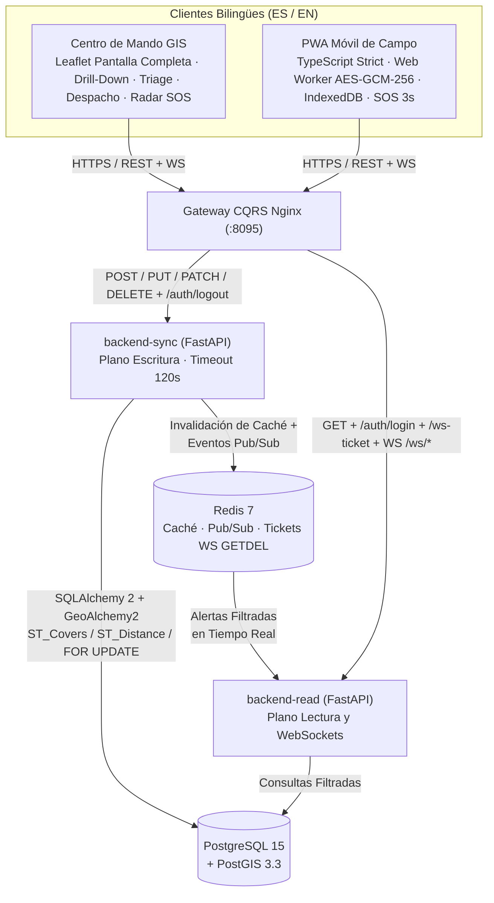

# Quantico Censo

> **Plataforma de Censo Comercial Geoespacial, PWA Offline-First Cifrada y Centro de Mando CQRS Multi-Tenant — por [Quantico Systems](https://quanticosystems.com).**

**Idioma / Language:** [🇺🇸 English (README.md)](README.md) · **🇪🇸 Español**

[](https://mc3yohan.github.io/quantico-censo/)
[](LICENSE)
[](backend/pyproject.toml)
[](docker-compose.yml)
[](frontend/tsconfig.json)

---

## Simulador Interactivo en Vivo (Sin Backend)

Prueba la plataforma bilingüe (**ES / EN**) directamente en tu navegador desde **GitHub Pages**:  
👉 **[https://mc3yohan.github.io/quantico-censo/](https://mc3yohan.github.io/quantico-censo/)**

- **Centro de Mando GIS a Pantalla Completa:** Franja desplegable de KPIs territoriales con *drill-down* Región → Territorio, panel lateral colapsable de Registros y Filtros con `flyTo`, mapa Leaflet con capas gratuitas sin API key (*OpenStreetMap Calles*, *Esri Satélite*, *Esri GIS*), polígonos urbanos orgánicos, pines GIS tipo gota, panel derecho deslizable de Detalle/Triage y modales operativos (*Triage*, *Despacho*, *Soporte Táctico*, *Estadísticas*, *Usuarios RBAC*, *Conectar API Docker*).
- **PWA Móvil Dedicada para Agentes (`📱 App Móvil`):** Interfaz móvil dedicada con cifrado real en Web Worker `PBKDF2-SHA256` (100.000 rondas) + `AES-GCM-256` + bóveda `IndexedDB` particionada por usuario, conmutador Offline, simuladores de Desvío GPS / Fuera de Zona / Conflicto `409` UUID y botón de pánico SOS de 3 segundos.

---

## Qué Demuestra Este Proyecto

**Quantico Censo** es una plataforma de referencia construida *clean-room* (desde cero) para censos comerciales de Puntos de Venta (PDV / Retail), auditorías de anaquel/POS y centros de mando territoriales en tiempo real. Resuelve los escenarios más exigentes de operaciones en campo:

1. **Separación CQRS Real por Método HTTP con Tiempo Real entre Contenedores:** Nginx enruta todas las mutaciones (`POST`/`PUT`/`PATCH`/`DELETE`, incluyendo `/api/v1/auth/logout`) hacia `backend-sync`, mientras atiende mapas, KPIs, emisión de tokens y WebSockets desde `backend-read`, sincronizados en vivo vía **Redis Pub/Sub**.
2. **RBAC Multi-Tenant y Aislamiento *Fail-Closed*:** Roles desacoplados (`super_admin`, `regional_manager`, `supervisor`, `field_agent`, `viewer`) enlazados mediante llaves foráneas `region_id` y `territory_id` en **todas las tablas operativas**, bloqueo estricto de escritura para `viewer`, bloqueos de fila PostgreSQL `FOR UPDATE` en transiciones de triage/SOS/rutas/tickets, revocación atómica de JWT (`token_version` con protección contra replay de logout) e interruptores por región/territorio.
3. **PWA Móvil Offline-First con Bóveda Cifrada:** Web Worker dedicado con `PBKDF2-SHA256` (100.000 iteraciones) y salt CSPRNG de 16 bytes por operador → clave `AES-GCM-256` no extraíble + IV aleatorio de 12 bytes por captura, persistido en `IndexedDB` particionado por usuario con recuperación explícita de conflictos (`pending` / `conflict` / `synced`) y sincronización idempotente en lotes (`<= 25`).
4. **Geocercas Antifraude PostGIS y Compuerta de Cuarentena:** Valida cada captura GPS de forma nativa con PostGIS `ST_Covers` / `ST_Distance` e índices espaciales `GiST` (con paridad en Shapely para tests en memoria). Capturas fuera de polígono, desvíos GPS (`> 150 m`), prospectos nuevos y quiebres críticos de stock ingresan automáticamente a la **Cola de Cuarentena y Triage**.
5. **WebSockets Zero-Trust, Evidencia Fotográfica Segura e Ingesta CSV:** Tickets WS de un solo uso con expiración de 30 s (`POST /api/v1/auth/ws-ticket`, nunca JWT en query strings) + validación de `Origin` + cierre en vivo por `SESSION_REVOKED` + reconexión con *backoff* exponencial, validación de magic-bytes con Pillow + auto-orientación y limpieza EXIF + reconversión a WebP con descargas restringidas por propietario, e importación/exportación CSV con neutralización contra inyección de fórmulas y BOM UTF-8.
6. **Pipeline CI de Extremo a Extremo:** GitHub Actions ejecuta la compuerta de higiene *clean-room*, 21 pruebas automatizadas de seguridad e integración, verificación TypeScript estricta + doble build Vite y una prueba **E2E real con Docker Compose (PostGIS 15 + Redis 7 + Nginx CQRS)**.

---

## Arquitectura del Sistema



---

## Dominio Comercial Sintético (`Solstice Retail Distribution`)

Todas las regiones, polígonos GeoJSON urbanos, puntos de venta (`OUT-1001`..`OUT-1018`), rutas y usuarios son **100% sintéticos**.

| Usuario Demo | Contraseña | Rol | Alcance Territorial |
| :--- | :--- | :--- | :--- |
| `admin_hq` | `QuanticoDemo2026!` | `super_admin` | Todas las Regiones (`Metro North` + `Coastal East`) |
| `manager_north` | `QuanticoDemo2026!` | `regional_manager` | `Metro North` (`Downtown Core` + `Innovation District`) |
| `manager_east` | `QuanticoDemo2026!` | `regional_manager` | `Coastal East` (`Harbor Strip` + `Midtown Commons`) |
| `sup_downtown` | `QuanticoDemo2026!` | `supervisor` | Territorio `Downtown Core` |
| `agent_downtown` | `QuanticoDemo2026!` | `field_agent` | `Downtown Core` (sus rutas y auditorías) |
| `agent_tech` | `QuanticoDemo2026!` | `field_agent` | `Innovation District` (sus rutas y auditorías) |
| `agent_harbor` | `QuanticoDemo2026!` | `field_agent` | `Harbor Strip` (sus rutas y auditorías) |
| `agent_midtown` | `QuanticoDemo2026!` | `field_agent` | `Midtown Commons` (sus rutas y auditorías) |
| `viewer_north` | `QuanticoDemo2026!` | `viewer` | `Metro North` (**estrictamente solo lectura**) |

---

## Inicio Rápido

### Opción 1 — Simulador Interactivo Sin Backend (GitHub Pages)
Abre **[https://mc3yohan.github.io/quantico-censo/](https://mc3yohan.github.io/quantico-censo/)** o abre [`docs/index.html`](docs/index.html) directamente en cualquier navegador para probar:
- **Bóveda Offline AES-GCM-256:** Entra en `📱 App Móvil`, activa *Offline*, captura una auditoría (o dispara *Desvío >150m*, *Fuera de Zona* o *Conflicto 409*), inspecciona el IV de 12 bytes y texto cifrado real en IndexedDB, reconecta y sincroniza por lotes.
- **Radar SOS de 3 Segundos:** Abre la pestaña SOS, mantén pulsado durante 3 segundos para encender una baliza pulsante en el mapa del Centro de Mando, inspecciona su detalle y ciérrala en vivo.
- **Selector RBAC e Idioma ES/EN:** Alterna perfiles (`HQ Admin`, `Metro North`, `Coastal East`, `Field Agent`, `Viewer Solo Lectura`) y cambia toda la aplicación entre Español e Inglés al instante.

### Opción 2 — Stack Completo en Docker Compose (PostGIS + Redis + CQRS Nginx)
```bash
cp .env.example .env
docker compose up -d --build

# Abrir la plataforma completa:
#   Interfaz Web: http://127.0.0.1:8095
#   Swagger API:  http://127.0.0.1:8095/docs

# Verificación E2E en vivo (PostGIS ST_Covers + Redis Pub/Sub entre contenedores):
python scripts/verify_stack.py
```

### Opción 3 — Suite de Pruebas Locales y Compilación Frontend
```bash
# Pruebas unitarias, de integración y regresión de seguridad (en memoria, sin BD externa)
cd backend
pip install -e ".[dev]"
pytest -v

# Compuerta automática de sanitización clean-room
cd ..
python scripts/sanitize_check.py

# Verificación TypeScript estricta + doble build Vite (dist Docker + /docs GitHub Pages)
cd frontend
npm ci
npm run typecheck
npm run build
npm run build:docs
```

---

## Garantías de Seguridad e Ingeniería Verificadas por Pruebas Automatizadas

- **Aislamiento Multi-Tenant y Horizontal *Fail-Closed*:** Los intentos IDOR entre regiones o entre agentes pares en triage, rutas, alertas SOS, fotografías de evidencia, trabajos de importación y tickets son rechazados (`403` / `400`).
- **RBAC Pre-Mutación y Revocación de Sesiones:** Impide escalada de privilegios y secuestro territorial; cambios de clave, borrado lógico y cierre de sesión incrementan atómicamente `token_version` (bloqueando ataques de replay con JWTs antiguos) y preservan el historial inmutable de `SosAlert`.
- **WebSockets Zero-Trust y Defensa XSS:** Tickets de un solo uso con `GETDEL` (`4401`), lista blanca de `Origin` (`4403`), filtrado de eventos por rol/territorio, handshakes no bloqueantes y tooltips Leaflet seguros por DOM (`textContent`, cero `innerHTML` con datos de usuario).
- **Ingesta Endurecida y Concurrencia:** Bloqueos PostgreSQL `FOR UPDATE` en transiciones de estado, validación Pillow magic-bytes + auto-orientación/limpieza EXIF + conversión WebP, importación CSV masiva por lotes sin N+1 y exportación CSV protegida contra inyección de fórmulas con BOM UTF-8.

---

## Autoría y Licencia

Diseñado y desarrollado por **Víctor Yohan Betancourt Marín** — **[Quantico Systems](https://quanticosystems.com)**.  
Publicado bajo [Licencia MIT](LICENSE).
