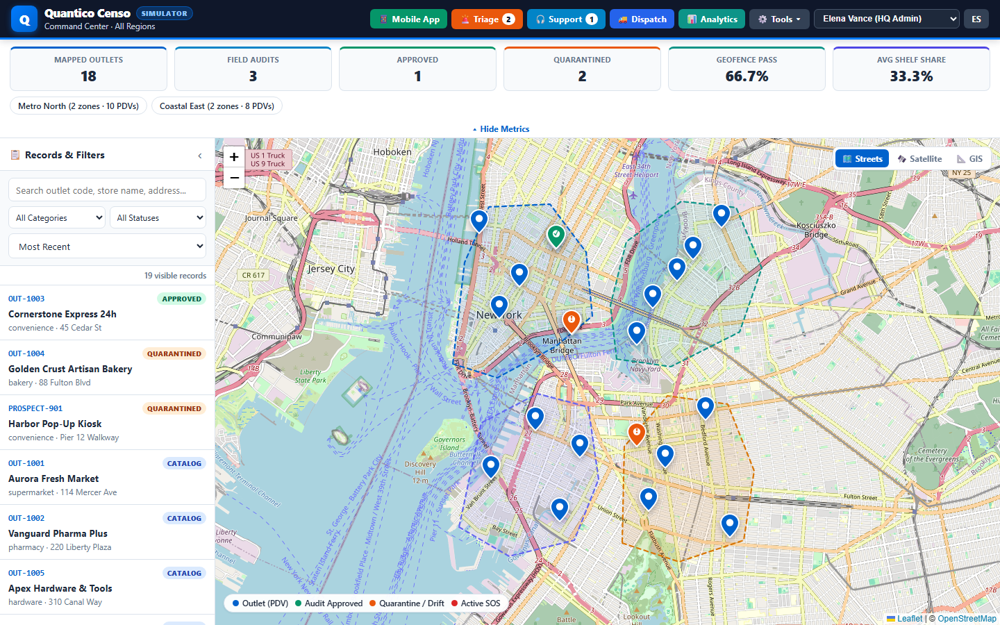
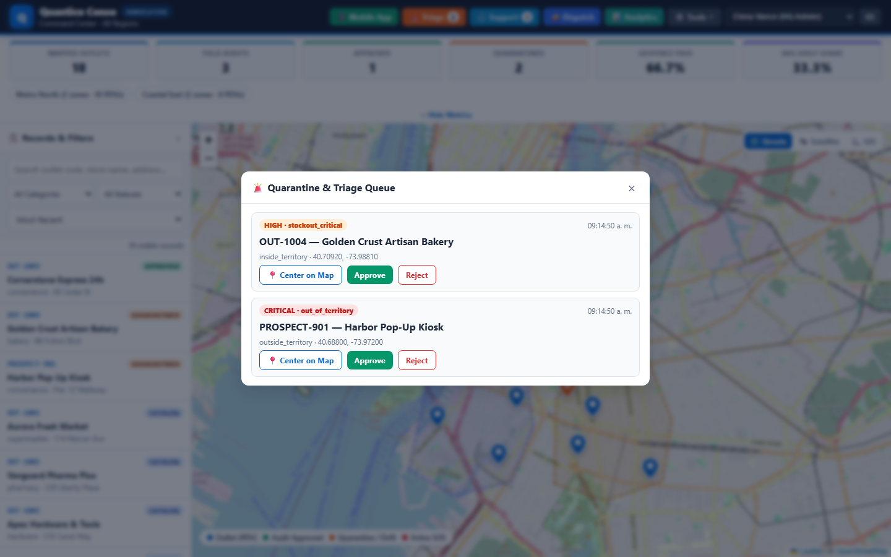
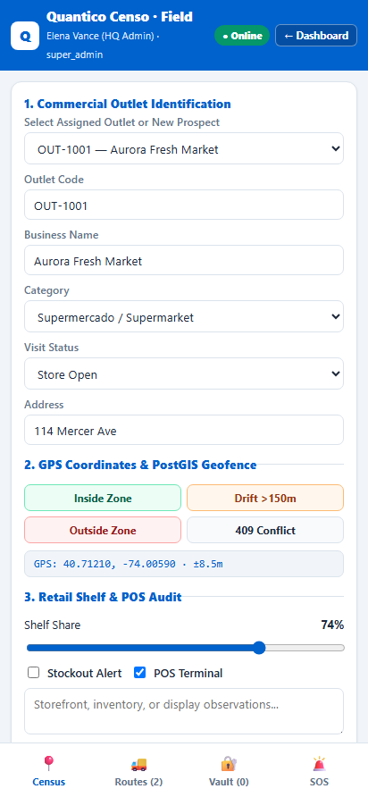
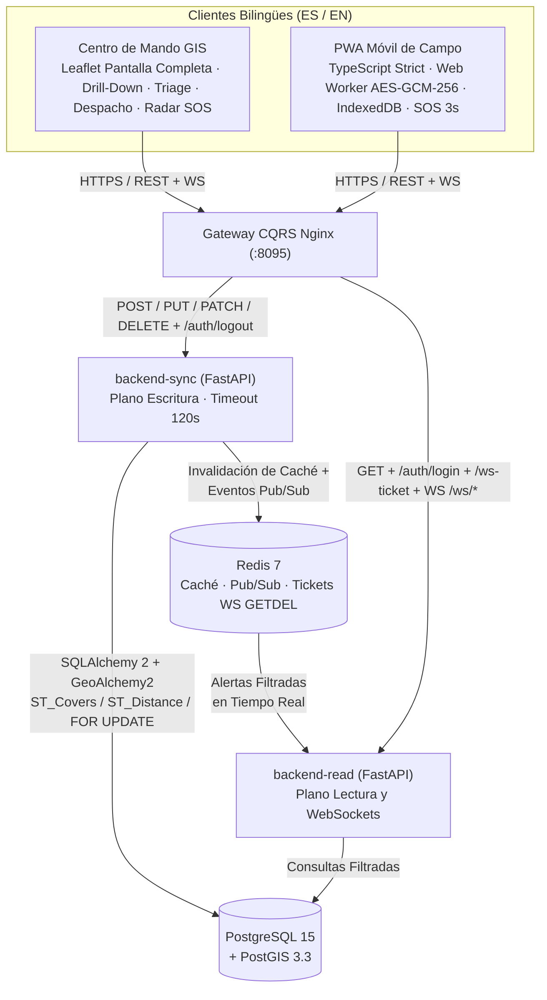

# Quantico Censo

**Idioma:** [English (README.md)](README.md) · **Español**

[](https://github.com/Mc3yohan/quantico-censo/actions/workflows/ci.yml)
[](https://mc3yohan.github.io/quantico-censo/)
[](LICENSE)

Plataforma geoespacial de censo comercial de puntos de venta (PDV), PWA móvil offline-first cifrada y centro de mando CQRS multi-tenant construida con **FastAPI**, **PostgreSQL / PostGIS**, **Redis**, **Nginx** y **TypeScript estricto + Leaflet**.

---

## Simulador Interactivo en Vivo (Sin Backend)

Prueba la plataforma bilingüe (**ES / EN**) directamente en tu navegador: **[mc3yohan.github.io/quantico-censo](https://mc3yohan.github.io/quantico-censo/)**



<table>
  <tr>
    <td width="64%" valign="top">
      
      <p align="center"><em>Flujo de cuarentena y triage por geocercas PostGIS</em></p>
    </td>
    <td width="36%" valign="top" align="center">
      
      <p align="center"><em>PWA móvil de campo (bóveda offline AES-GCM-256 y presets GPS)</em></p>
    </td>
  </tr>
</table>

---

## Decisiones de Ingeniería

Las herramientas de censo en campo suelen fallar en cuatro frentes: señal móvil intermitente, capturas GPS desviadas o simuladas, fugas de datos entre territorios y contención de escritura en horas pico de sincronización. Esta plataforma ataca cada uno:

1. **Separación CQRS por método HTTP detrás de Nginx + Redis Pub/Sub:** Nginx enruta mutaciones (`POST`/`PUT`/`PATCH`/`DELETE`, más `/api/v1/auth/logout`) hacia `backend-sync`, mientras atiende mapas, KPIs y WebSockets desde `backend-read`, conectados en tiempo real vía Redis Pub/Sub.
2. **RBAC multi-tenant con alcance estricto (`FOR UPDATE` + revocación atómica):** Cinco roles (`super_admin`, `regional_manager`, `supervisor`, `field_agent`, `viewer`) acotados por llaves foráneas `region_id` y `territory_id` en todas las tablas operativas, bloqueos PostgreSQL `FOR UPDATE` en transiciones de estado y revocación atómica de JWT mediante `token_version` (protegida contra replay de logout con tokens vencidos).
3. **Bóveda móvil offline cifrada:** Web Worker dedicado con `PBKDF2-SHA256` (100.000 iteraciones y salt CSPRNG de 16 bytes por operador) para derivar una llave `AES-GCM-256` no extraíble, cifrando cada auditoría offline con un IV aleatorio de 12 bytes en `IndexedDB` particionado por usuario y sincronizando en lotes idempotentes por UUID (`<= 25` ítems) con estados `pending` / `conflict` / `synced`.
4. **Geocercas antifraude PostGIS y compuerta de cuarentena:** Evalúa cada punto GPS con PostGIS `ST_Covers` / `ST_Distance` e índices espaciales `GiST` (con paridad en Shapely para pruebas en memoria). Capturas fuera de polígono, desvíos (`> 150 m`), prospectos nuevos y quiebres críticos de stock pasan automáticamente a la cola de Cuarentena y Triage.
5. **WebSockets, evidencia fotográfica y CSV endurecidos:** Tickets WS de un solo uso con expiración de 30 s (`POST /api/v1/auth/ws-ticket` consumidos con `GETDEL` en Redis, nunca JWTs en la URL), validación de `Origin`, verificación Pillow de magic-bytes + limpieza EXIF + conversión a WebP, e importación/exportación CSV protegida contra inyección de fórmulas (UTF-8 BOM).

---

## Arquitectura del Sistema



---

## Cuentas Demo (Dominio Sintético: `Solstice Retail Distribution`)

Todas las regiones, polígonos GeoJSON, puntos de venta (`OUT-1001`..`OUT-1018`), rutas y usuarios son sintéticos.

| Usuario | Contraseña | Rol | Alcance Territorial |
| :--- | :--- | :--- | :--- |
| `admin_hq` | `QuanticoDemo2026!` | `super_admin` | Todas las Regiones (`Metro North` + `Coastal East`) |
| `manager_north` | `QuanticoDemo2026!` | `regional_manager` | `Metro North` (`Downtown Core` + `Innovation District`) |
| `manager_east` | `QuanticoDemo2026!` | `regional_manager` | `Coastal East` (`Harbor Strip` + `Midtown Commons`) |
| `sup_downtown` | `QuanticoDemo2026!` | `supervisor` | `Downtown Core` |
| `agent_downtown` | `QuanticoDemo2026!` | `field_agent` | `Downtown Core` (sus rutas y auditorías) |
| `agent_tech` | `QuanticoDemo2026!` | `field_agent` | `Innovation District` (sus rutas y auditorías) |
| `agent_harbor` | `QuanticoDemo2026!` | `field_agent` | `Harbor Strip` (sus rutas y auditorías) |
| `agent_midtown` | `QuanticoDemo2026!` | `field_agent` | `Midtown Commons` (sus rutas y auditorías) |
| `viewer_north` | `QuanticoDemo2026!` | `viewer` | `Metro North` (estrictamente solo lectura) |

---

## Inicio Rápido

### 1. Simulador en Navegador (Sin Instalación)
Abre **[mc3yohan.github.io/quantico-censo](https://mc3yohan.github.io/quantico-censo/)** o abre [`docs/index.html`](docs/index.html) en tu navegador:
- **Bóveda Offline AES-GCM-256:** Entra en **App Móvil**, activa **Offline**, captura una auditoría (o simula *Desvío >150m*, *Fuera de Zona* o *Conflicto 409*), inspecciona el IV de 12 bytes y texto cifrado en `IndexedDB`, reconecta y sincroniza por lotes.
- **Baliza SOS de 3 segundos:** En la pestaña **SOS**, mantén pulsado 3 segundos para disparar una alerta en el mapa del Centro de Mando y cerrarla en vivo.
- **Selector RBAC e idioma ES/EN:** Alterna perfiles (`HQ Admin`, `Metro North`, `Coastal East`, `Field Agent`, `Viewer`) y cambia de idioma al instante.

### 2. Stack Completo con Docker Compose (PostGIS + Redis + Nginx CQRS)
```bash
cp .env.example .env
docker compose up -d --build

# Interfaz Web: http://127.0.0.1:8095
# Swagger API:  http://127.0.0.1:8095/docs

# Verificación E2E en vivo (PostGIS ST_Covers + Redis Pub/Sub entre contenedores):
python scripts/verify_stack.py
```

### 3. Pruebas Locales y Build Frontend
```bash
# Suite de seguridad e integración backend (21 pruebas en memoria, sin BD externa)
cd backend
pip install -e ".[dev]"
pytest -v

# Compuerta de higiene y secretos
cd ..
python scripts/sanitize_check.py

# Verificación TypeScript estricta + builds Vite (dist Docker + /docs GitHub Pages)
cd frontend
npm ci
npm run typecheck
npm run build
npm run build:docs
```

---

## Verificación Automatizada en CI

GitHub Actions ejecuta tres jobs en cada push a `main`:
- **`sanitize-and-backend`:** Escaneo UTF-8/secretos + 21 pruebas backend validando rechazo IDOR (`403`/`400`), prevención de escalada de roles, revocación por `token_version`, validación WebSocket `GETDEL`/`Origin` (`4401`/`4403`), limpieza EXIF en imágenes y neutralización de fórmulas en CSV.
- **`frontend-build`:** `tsc --noEmit` + build de producción Vite + build single-file para GitHub Pages.
- **`docker-cqrs-postgis-e2e`:** Levanta PostgreSQL 15 + PostGIS 3.3, Redis 7, `backend-sync`, `backend-read` y Nginx, y ejecuta `scripts/verify_stack.py` de punta a punta.

---

## Autoría y Licencia

Desarrollado por **Víctor Yohan Betancourt Marín** — [quanticosystems.com](https://quanticosystems.com).  
Publicado bajo [Licencia MIT](LICENSE).
