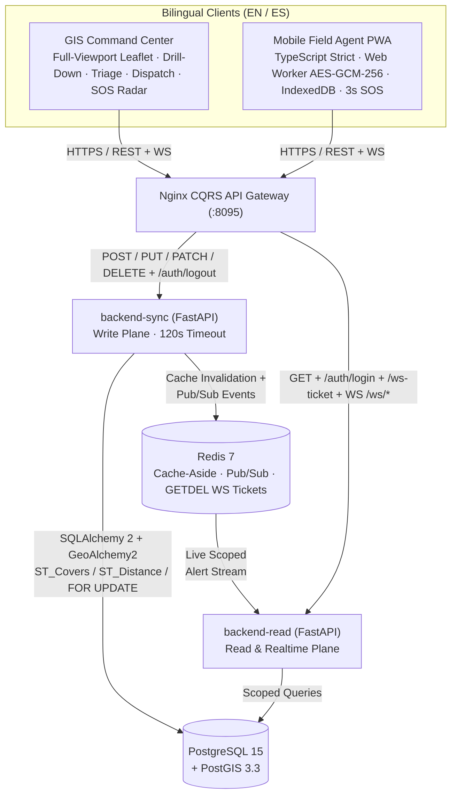

# Quantico Censo

> **Geospatial Retail Census, Offline-First Encrypted Field PWA & Multi-Tenant CQRS Command Center — by [Quantico Systems](https://quanticosystems.com).**

**Language / Idioma:** **🇺🇸 English** · [🇪🇸 Español (README.es.md)](README.es.md)

[](https://mc3yohan.github.io/quantico-censo/)
[](LICENSE)
[](backend/pyproject.toml)
[](docker-compose.yml)
[](frontend/tsconfig.json)

---

## Live Interactive Simulator (Zero Backend)

Try the full bilingual (**EN / ES**) client directly in your browser on **GitHub Pages**:  
👉 **[https://mc3yohan.github.io/quantico-censo/](https://mc3yohan.github.io/quantico-censo/)**

- **Full-Viewport GIS Command Center:** Collapsible territorial KPI strip with Region → Territory drill-down, collapsible left Records & Filters drawer with `flyTo`, full-bleed Leaflet map with zero-API-key tile layers (*OpenStreetMap Streets*, *Esri World Imagery Satellite*, *Esri World Street GIS*), organic urban territory polygons, teardrop GIS pins, right slide-in Detail & Triage drawer, and operational modals (*Triage*, *Route Dispatch*, *Tactical Support*, *Coverage Analytics*, *RBAC Users*, *Connect Live Docker API*).
- **Dedicated Mobile Field Agent PWA (`📱 Mobile App`):** Separate mobile-first field interface with real Web Worker `PBKDF2-SHA256` (100,000 rounds) + `AES-GCM-256` + user-scoped `IndexedDB` vault, offline toggle, GPS drift / out-of-zone spoof / `409` UUID conflict simulator presets, and 3-second long-press SOS safety beacon.

---

## What It Demonstrates

**Quantico Censo** is a clean-room, production-grade reference platform for commercial point-of-sale (POS/PDV) census, retail merchandising audits, and real-time territorial command centers. It addresses the hardest engineering failure modes of field-operations platforms:

1. **True HTTP-Method CQRS Split with Cross-Container Realtime:** Nginx routes all mutating API requests (`POST`/`PUT`/`PATCH`/`DELETE`, including `/api/v1/auth/logout`) to `backend-sync` while serving maps, KPIs, token minting, and WebSockets from `backend-read`, bridged live via **Redis Pub/Sub**.
2. **Multi-Tenant RBAC & Fail-Closed Scoping:** Decoupled roles (`super_admin`, `regional_manager`, `supervisor`, `field_agent`, `viewer`) bound to `region_id` and `territory_id` foreign keys across **every operational table**, read-only enforcement on `viewer`, row-level PostgreSQL `FOR UPDATE` locking on triage/SOS/dispatch/ticket transitions, atomic JWT revocation (`token_version` + stale-token logout replay protection), and region/territory kill-switches.
3. **Offline-First Encrypted Field PWA:** Dedicated Web Worker running `PBKDF2-SHA256` (100,000 iterations) with a random 16-byte CSPRNG salt per operator → non-extractable `AES-GCM-256` `CryptoKey` + random 12-byte IV per capture, persisted in a user-partitioned `IndexedDB` vault with explicit conflict recovery (`pending` / `conflict` / `synced`) and chunked UUID-idempotent batch sync (`<= 25` items).
4. **PostGIS Anti-Fraud Geofencing & Quarantine Gate:** Evaluates every GPS capture natively via PostGIS `ST_Covers` / `ST_Distance` with `GiST` spatial indexes (and Shapely parity for in-memory tests). Out-of-territory captures, GPS drift (`> 150m`), unmapped prospects, and critical stockouts automatically route into the prioritized **Quarantine & Triage Queue**.
5. **Zero-Trust WebSockets, Hardened Media & CSV Ingestion:** Single-use 30-second WS tickets (`POST /api/v1/auth/ws-ticket`, never raw JWTs in URLs) + `Origin` validation + live `SESSION_REVOKED` close + exponential-backoff reconnect, Pillow magic-byte verification with EXIF auto-orientation & stripping + WebP re-encoding + owner-scoped downloads, and formula-injection-neutralized CSV import/export (UTF-8 BOM).
6. **End-to-End CI Pipeline:** GitHub Actions runs clean-room hygiene checks, 21 automated backend security/integration tests, strict TypeScript + dual Vite builds, and a live **Docker Compose PostGIS + Redis CQRS E2E verification job**.

---

## System Architecture



---

## Synthetic Demo Domain (`Solstice Retail Distribution`)

All regions, GeoJSON urban territory polygons, retail outlets (`OUT-1001`..`OUT-1018`), routes, and operators are **100% synthetic**.

| Demo Username | Password | Role | Territorial Scope |
| :--- | :--- | :--- | :--- |
| `admin_hq` | `QuanticoDemo2026!` | `super_admin` | All Regions (`Metro North` + `Coastal East`) |
| `manager_north` | `QuanticoDemo2026!` | `regional_manager` | `Metro North` (`Downtown Core` + `Innovation District`) |
| `manager_east` | `QuanticoDemo2026!` | `regional_manager` | `Coastal East` (`Harbor Strip` + `Midtown Commons`) |
| `sup_downtown` | `QuanticoDemo2026!` | `supervisor` | `Downtown Core` territory |
| `agent_downtown` | `QuanticoDemo2026!` | `field_agent` | `Downtown Core` (own routes & audits) |
| `agent_tech` | `QuanticoDemo2026!` | `field_agent` | `Innovation District` (own routes & audits) |
| `agent_harbor` | `QuanticoDemo2026!` | `field_agent` | `Harbor Strip` (own routes & audits) |
| `agent_midtown` | `QuanticoDemo2026!` | `field_agent` | `Midtown Commons` (own routes & audits) |
| `viewer_north` | `QuanticoDemo2026!` | `viewer` | `Metro North` (**strictly read-only**) |

---

## Quick Start

### Option 1 — Instant Interactive Simulator (Zero Backend / GitHub Pages)
Open **[https://mc3yohan.github.io/quantico-censo/](https://mc3yohan.github.io/quantico-censo/)** or open [`docs/index.html`](docs/index.html) directly in any browser to test:
- **Offline AES-GCM-256 Vault:** Open `📱 Mobile App`, toggle *Offline*, capture an audit (or test *Drift >150m*, *Outside Zone*, or *409 Conflict*), inspect the real 12-byte IV & AES-GCM ciphertext in IndexedDB, go back online, and batch-sync.
- **3-Second Long-Press SOS Radar:** Open the SOS tab, press and hold for 3 seconds to broadcast a pulsing crimson SOS beacon onto the Command Center map, inspect it, and dispatch-resolve it.
- **RBAC Persona & EN/ES Switcher:** Switch personas live (`HQ Admin`, `Metro North`, `Coastal East`, `Field Agent`, `Read-Only Viewer`) and toggle the entire platform between English and Spanish instantly.

### Option 2 — Full-Stack Docker Compose (PostGIS + Redis + CQRS Nginx)
```bash
cp .env.example .env
docker compose up -d --build

# Open the bilingual full-stack platform:
#   Web UI:      http://127.0.0.1:8095
#   Swagger API: http://127.0.0.1:8095/docs

# Run live E2E verification (PostGIS ST_Covers + Cross-Container Redis Pub/Sub WS):
python scripts/verify_stack.py
```

### Option 3 — Local Backend Tests & Frontend Build
```bash
# Backend unit, integration & security regression suite (in-memory, zero DB setup)
cd backend
pip install -e ".[dev]"
pytest -v

# Clean-room sanitization gate
cd ..
python scripts/sanitize_check.py

# Strict TypeScript check + Dual Vite Build (Docker dist + GitHub Pages /docs)
cd frontend
npm ci
npm run typecheck
npm run build
npm run build:docs
```

---

## Security & Engineering Guarantees Verified by Automated Tests

- **Fail-Closed Multi-Tenant & Horizontal Isolation:** Cross-region and horizontal peer-agent IDOR attempts on triage, dispatch routes, SOS alerts, evidence photos, import jobs, and support tickets are rejected (`403` / `400`).
- **Pre-Mutation RBAC & Session Revocation Hardening:** Prevents peer takeover, role escalation, and territory hijack; password rotation, soft-delete, and active-token logout atomically bump `token_version` (while rejecting stale-token logout replay DoS) and preserve immutable `SosAlert` records.
- **Zero-Trust WebSockets & XSS Defense:** Single-use `GETDEL` tickets (`4401`), `Origin` allowlist (`4403`), per-role event filtering, non-blocking handshake threads, and DOM-safe Leaflet tooltips (`textContent`, zero `innerHTML` on user data).
- **Hardened Ingestion & Concurrency:** PostgreSQL `FOR UPDATE` locks on state transitions, Pillow magic-byte + EXIF transpose/strip + WebP transcoding, bulk-prefetched formula-safe CSV imports, and formula-neutralized UTF-8 BOM CSV exports.

---

## Author & License

Designed and engineered by **Víctor Yohan Betancourt Marín** — **[Quantico Systems](https://quanticosystems.com)**.  
Released under the [MIT License](LICENSE).
