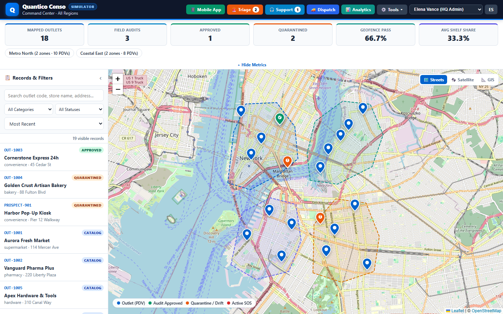
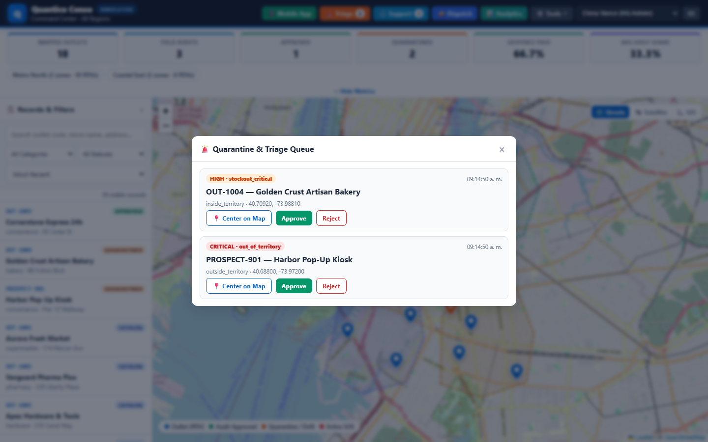
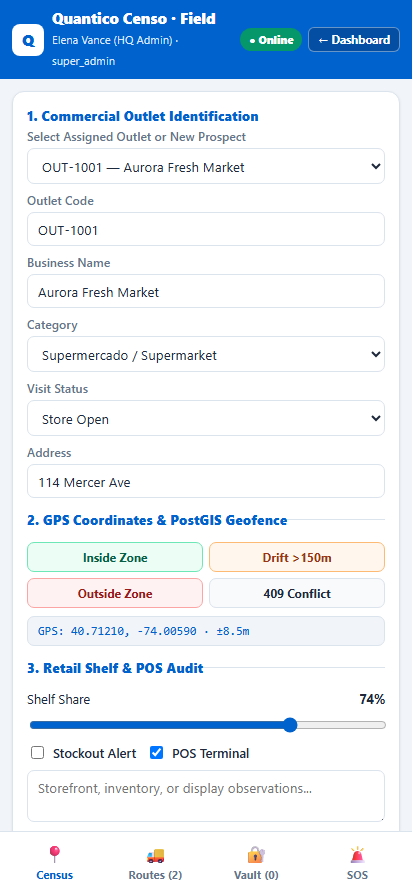
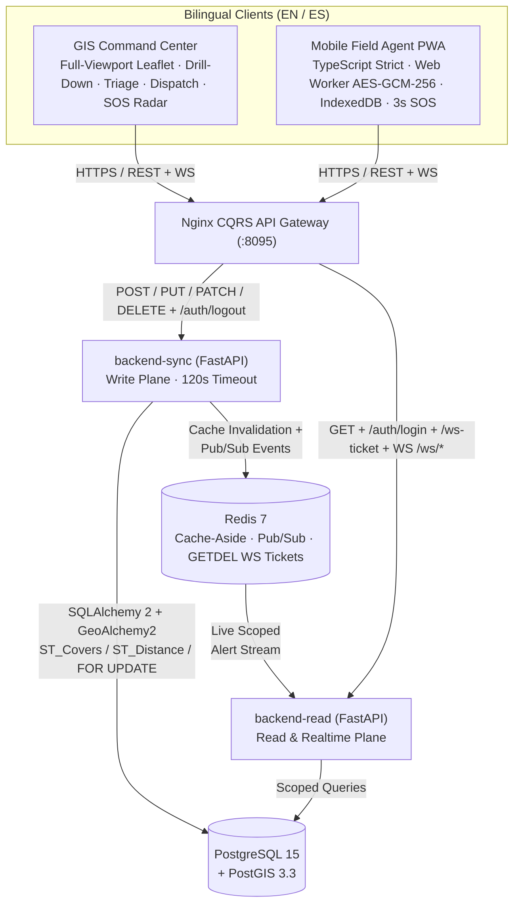

# Quantico Censo

**Language:** **English** · [Español (README.es.md)](README.es.md)

[](https://github.com/Mc3yohan/quantico-censo/actions/workflows/ci.yml)
[](https://mc3yohan.github.io/quantico-censo/)
[](LICENSE)

Geospatial point-of-sale (POS/PDV) census platform, offline-first encrypted field PWA, and multi-tenant CQRS command center built with **FastAPI**, **PostgreSQL / PostGIS**, **Redis**, **Nginx**, and strict **TypeScript + Leaflet**.

---

## Live Interactive Simulator (No Backend Required)

Try the full bilingual (**EN / ES**) client directly in your browser: **[mc3yohan.github.io/quantico-censo](https://mc3yohan.github.io/quantico-censo/)**



<table>
  <tr>
    <td width="64%" valign="top">
      
      <p align="center"><em>PostGIS geofence quarantine &amp; triage workflow</em></p>
    </td>
    <td width="36%" valign="top" align="center">
      
      <p align="center"><em>Mobile field PWA (AES-GCM-256 offline vault &amp; GPS presets)</em></p>
    </td>
  </tr>
</table>

---

## Key Engineering Choices

Field-census tools usually break in four places: flaky mobile connectivity, spoofed or drifted GPS captures, cross-territory data leaks, and write contention during end-of-day sync spikes. This platform addresses each directly:

1. **HTTP-Method CQRS behind Nginx + Redis Pub/Sub:** Nginx routes mutations (`POST`/`PUT`/`PATCH`/`DELETE`, plus `/api/v1/auth/logout`) to `backend-sync` and read/map/KPI/WebSocket traffic to `backend-read`, bridged via Redis Pub/Sub for live dashboard updates.
2. **Scoped Multi-Tenant RBAC (`FOR UPDATE` + Atomic Session Revocation):** Five roles (`super_admin`, `regional_manager`, `supervisor`, `field_agent`, `viewer`) scoped by `region_id` and `territory_id` foreign keys across operational tables, row-level PostgreSQL `FOR UPDATE` locking on state transitions, and atomic `token_version` JWT revocation (with stale-token logout replay protection).
3. **Offline-First Encrypted Mobile Vault:** Dedicated Web Worker running `PBKDF2-SHA256` (100,000 iterations, per-user 16-byte CSPRNG salt) to derive a non-extractable `AES-GCM-256` `CryptoKey`, encrypting every offline audit with a fresh 12-byte IV in user-partitioned `IndexedDB` with chunked UUID-idempotent batch sync (`<= 25` items) and explicit `pending` / `conflict` / `synced` recovery.
4. **PostGIS Geofencing & Quarantine Gate:** Evaluates GPS captures natively with PostGIS `ST_Covers` / `ST_Distance` and `GiST` spatial indexes (with Shapely parity for in-memory tests). Out-of-territory points, GPS drift (`> 150m`), unmapped prospects, and critical stockouts route automatically into the Quarantine & Triage Queue.
5. **Hardened WebSockets, Media & CSV Pipeline:** Single-use 30-second WS tickets (`POST /api/v1/auth/ws-ticket` consumed via Redis `GETDEL`, never JWTs in query strings), `Origin` allowlisting, Pillow magic-byte validation + EXIF auto-orient/strip + WebP re-encoding, and formula-injection-safe UTF-8 BOM CSV import/export.

---

## System Architecture



---

## Demo Accounts (Synthetic Domain: `Solstice Retail Distribution`)

All regions, GeoJSON polygons, retail outlets (`OUT-1001`..`OUT-1018`), routes, and users are synthetic.

| Username | Password | Role | Territorial Scope |
| :--- | :--- | :--- | :--- |
| `admin_hq` | `QuanticoDemo2026!` | `super_admin` | All Regions (`Metro North` + `Coastal East`) |
| `manager_north` | `QuanticoDemo2026!` | `regional_manager` | `Metro North` (`Downtown Core` + `Innovation District`) |
| `manager_east` | `QuanticoDemo2026!` | `regional_manager` | `Coastal East` (`Harbor Strip` + `Midtown Commons`) |
| `sup_downtown` | `QuanticoDemo2026!` | `supervisor` | `Downtown Core` |
| `agent_downtown` | `QuanticoDemo2026!` | `field_agent` | `Downtown Core` (own routes & audits) |
| `agent_tech` | `QuanticoDemo2026!` | `field_agent` | `Innovation District` (own routes & audits) |
| `agent_harbor` | `QuanticoDemo2026!` | `field_agent` | `Harbor Strip` (own routes & audits) |
| `agent_midtown` | `QuanticoDemo2026!` | `field_agent` | `Midtown Commons` (own routes & audits) |
| `viewer_north` | `QuanticoDemo2026!` | `viewer` | `Metro North` (strictly read-only) |

---

## Quick Start

### 1. Browser Simulator (Zero Setup)
Open **[mc3yohan.github.io/quantico-censo](https://mc3yohan.github.io/quantico-censo/)** or open [`docs/index.html`](docs/index.html) locally:
- **Offline AES-GCM-256 Vault:** Switch to **Mobile App**, toggle **Offline**, capture an audit (or trigger *Drift >150m*, *Outside Zone*, or *409 Conflict*), inspect the 12-byte IV & ciphertext in `IndexedDB`, reconnect, and batch-sync.
- **3-Second SOS Beacon:** Open the **SOS** tab and hold for 3 seconds to broadcast an active alert onto the Command Center map and resolve it.
- **RBAC Persona & EN/ES Switcher:** Switch personas (`HQ Admin`, `Metro North`, `Coastal East`, `Field Agent`, `Read-Only Viewer`) and toggle English/Spanish live.

### 2. Full Docker Compose Stack (PostGIS + Redis + CQRS Nginx)
```bash
cp .env.example .env
docker compose up -d --build

# Web UI:      http://127.0.0.1:8095
# Swagger API: http://127.0.0.1:8095/docs

# Live E2E check (PostGIS ST_Covers + cross-container Redis Pub/Sub WS):
python scripts/verify_stack.py
```

### 3. Local Tests & Frontend Build
```bash
# Backend security & integration suite (21 tests, in-memory SQLite + Shapely)
cd backend
pip install -e ".[dev]"
pytest -v

# Secret & hygiene check
cd ..
python scripts/sanitize_check.py

# Strict TypeScript check + Vite builds (Docker dist + GitHub Pages /docs)
cd frontend
npm ci
npm run typecheck
npm run build
npm run build:docs
```

---

## Automated Verification Coverage (CI)

GitHub Actions runs three jobs on every push to `main`:
- **`sanitize-and-backend`:** Secret/UTF-8 scan + 21 backend tests covering cross-region/peer-agent IDOR rejection (`403`/`400`), privilege-escalation prevention, `token_version` revocation, WebSocket `GETDEL`/`Origin` checks (`4401`/`4403`), media EXIF stripping, and formula-safe CSV ingestion.
- **`frontend-build`:** `tsc --noEmit` + Vite production build + single-file GitHub Pages build.
- **`docker-cqrs-postgis-e2e`:** Boots PostgreSQL 15 + PostGIS 3.3, Redis 7, `backend-sync`, `backend-read`, and Nginx, then runs `scripts/verify_stack.py` end-to-end.

---

## Author & License

Built by **Víctor Yohan Betancourt Marín** — [quanticosystems.com](https://quanticosystems.com).  
Released under the [MIT License](LICENSE).
